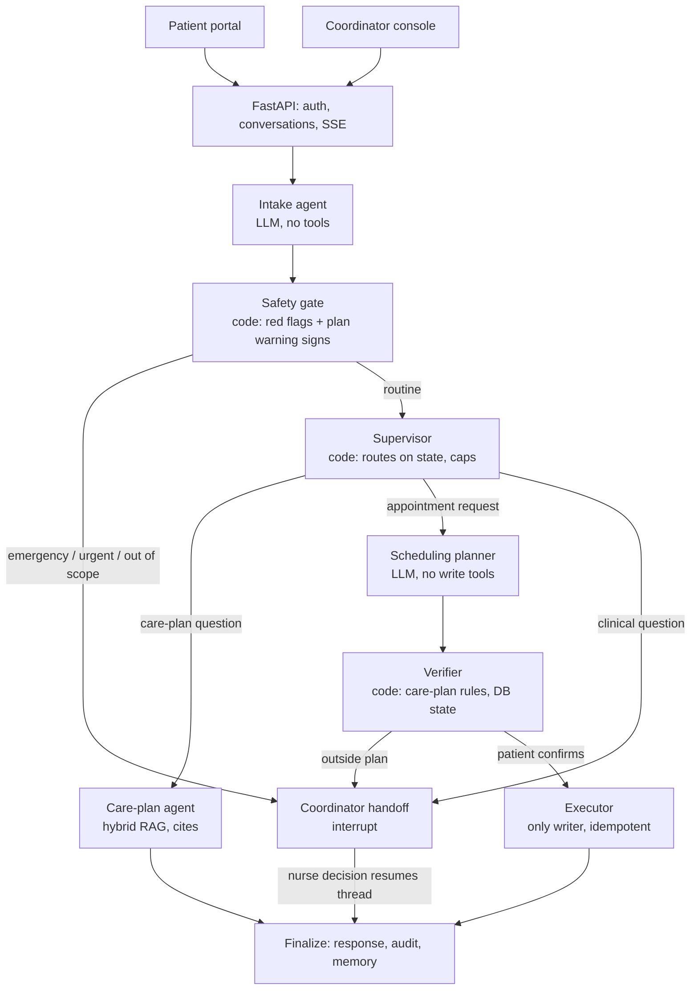

# CareFlow architecture

This document summarises the design in the [proposal](proposal.pdf). Section 4 of the proposal explains why each part exists. If a decision changes, update both documents.

## Request flow

LangGraph checkpoints the workflow state in PostgreSQL after every node. Each patient request runs on its own thread, so a request waiting hours for a coordinator is not disturbed by later messages. A patient confirmation or a coordinator decision resumes that thread, even after a server restart.

## Components and permissions

| Component | Type | Sees | May do |
|---|---|---|---|
| Intake agent | LLM | Raw message, recent turns | Emit a validated `IntakeRecord`. No tools. |
| Safety gate | Code | Intake record, raw text, plan warning signs | Escalate. No downstream component can overrule it. |
| Supervisor | Code | Workflow state | Route items. Enforce loop, token and time caps. |
| Care-plan agent | LLM | Normalised question, source-tagged chunks | Read-only search. Must cite, otherwise hand off. |
| Scheduling planner | LLM | Structured request, care-plan items, free slots | Propose a plan. No write tools. |
| Verifier | Code | Plan, current database state | Approve, deny, or require coordinator approval. |
| Executor | Code | Verified and confirmed plan | The only caller of `actions` write tools. |
| Memory manager | LLM + code | Finished session transcript | Write validated non-clinical memories. Consolidate them. |

## Invariants

These rules must hold throughout the project. Tests enforce them.

1. Raw patient text reaches only the intake agent, and the intake agent has no tools.
2. Only the executor calls write tools, and every write carries an idempotency key. Appointment changes follow patient confirmation, plus coordinator approval when they fall outside the care plan. Coordinator tasks (escalations and hand-offs) are created without confirmation.
3. The patient id for every tool call comes from the authenticated session, never from model output.
4. A safety-gate escalation cannot be overruled downstream. Emergency replies are fixed templates.
5. Every clinical statement in a reply cites a retrieved chunk from the patient's current documents or the shared protocols. If it cannot, the question is handed off.
6. Clinical facts (medications, allergies, diagnoses) come only from the record and are never stored as memory. If a patient reports a clinical change in chat, CareFlow creates a coordinator task.
7. Every loop has a hard cap: repair, replan and supervisor routing.

## Data model

PostgreSQL with pgvector is the single store.

- Clinical (synthetic, FHIR-like): `patients`, `encounters`, `care_plans` (versioned, immutable once published), `care_plan_items` (follow-up, lab, medication, warning sign with severity, activity rule).
- Scheduling: `clinicians`, `slots`, `appointments` (linked to the care-plan item they fulfil). There is one active booking per slot, and idempotency keys are unique.
- Interaction history: `conversations`, `workflow_runs` (one LangGraph thread per patient request), `messages`, `memories` (type, key, content, source conversation, embedding, `superseded_by`).
- Knowledge: `documents` (owner or shared, version, effective dates) and `chunks` (section id, `tsvector`, embedding).
- Operations: `coordinator_tasks`, append-only `audit_events` with `trace_id`, and the LangGraph checkpoint tables.

## Retrieval

The pipeline runs in this order: metadata filter (the patient's current documents plus the shared protocols), PostgreSQL full-text and pgvector search fused with Reciprocal Rank Fusion, cross-encoder rerank from 20 candidates to 4, source-tagged context, and a citation check.

## Memory

| Type | Where | Rule |
|---|---|---|
| Working | Graph state: recent turns plus a rolling summary | Test that key facts survive summarisation |
| Episodic | Session summaries and timestamped events | Written at the end of the session |
| Semantic | Non-clinical preferences, transport, caregiver | Must pass schema validation. Consolidated between sessions. |
| Procedural | Versioned prompts and protocol files | Changed only by developers |
